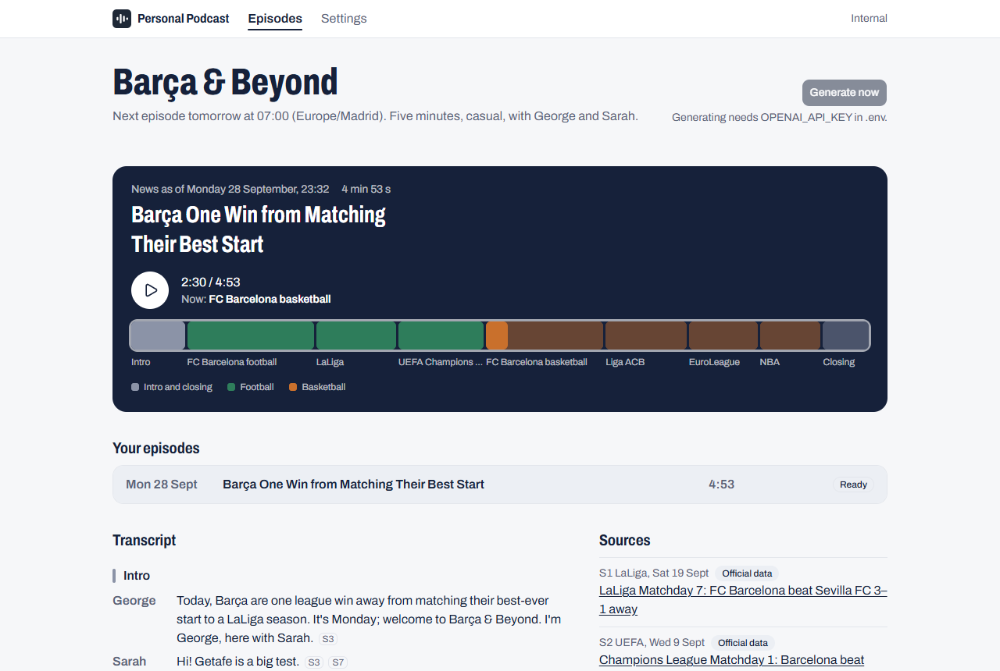
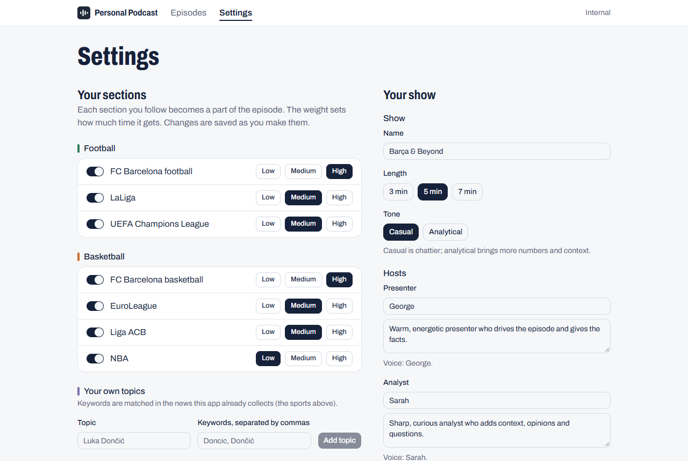
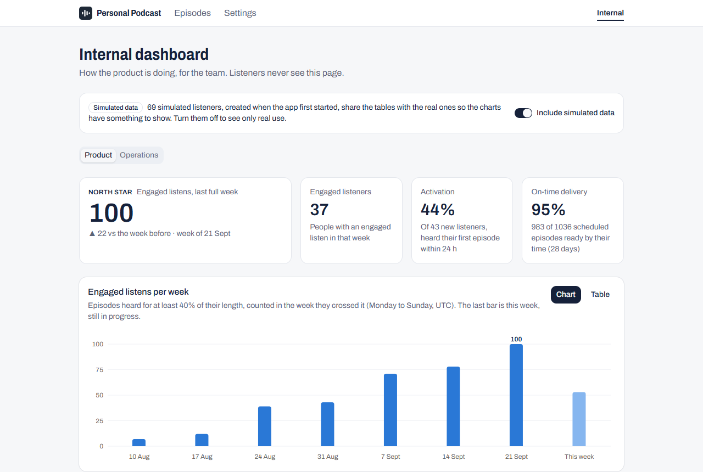
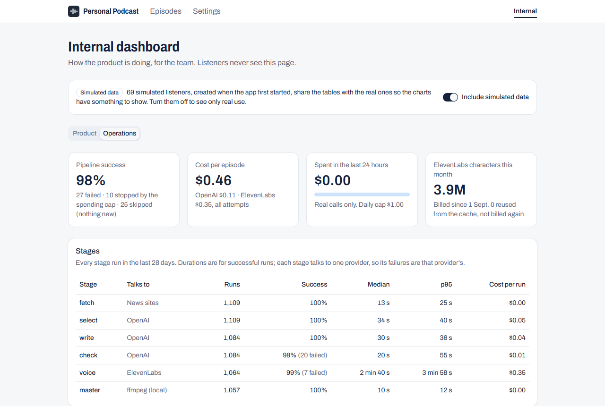

# Personal Podcast Generator

A personal sports podcast. The listener chooses what they follow; on their schedule, the app
gathers the news from official sources and reference outlets, writes a conversation between two
hosts, checks every fact against its source, and voices it with ElevenLabs.

**Listen first: [`sample.mp3`](sample.mp3)**, a 5-minute episode of "Barça & Beyond" generated by
the product. How it was made, and every decision behind the product, is in
[solution.md](solution.md).

| Episodes | Settings |
| --- | --- |
|  |  |
| **Internal dashboard: product** | **Internal dashboard: operations** |
|  |  |

## What it does

- **Listener app** (`/` and `/settings`): choose sections from a catalogue (FC Barcelona football
  and basketball, LaLiga, the Champions League, the EuroLeague, the Liga ACB and the NBA) or add
  your own keywords, and weight each one; name the show; pick 3, 5 or 7 minutes, a casual or
  analytical tone, the two hosts' names and personalities, and the days and time. Then listen:
  a player with chapters, the transcript, and every source the hosts cite.
- **Backend**: a worker ingests the sources every three hours (official APIs, RSS feeds, sitemaps
  and official pages, respecting `robots.txt`) and generates each episode in six recorded stages:
  fetch → select → write → check → voice → master.
- **Internal dashboard** (`/internal`): product metrics around one North Star, *engaged listens
  per week*, and operations metrics (cost, success rate and latency per stage). It ships with
  simulated listeners, clearly marked, and real listening goes through the same queries.

## Quick start (no API keys needed)

Requirements: Docker with Compose 2.24 or later (Docker Desktop is enough).

```bash
git clone https://github.com/carco5/personal-podcast-generator.git
cd personal-podcast-generator
docker compose up --build
```

The first build takes a few minutes. Then open **<http://127.0.0.1:8000>**.

- Without keys, everything works except generating: the sample episode plays with its chapters,
  transcript and sources, the settings can be edited, and the dashboard is full of simulated data.
- "Generate now" is disabled and says which key is missing; the API answers `503` and names it.
- The API documentation is at <http://127.0.0.1:8000/docs>.
- Use `127.0.0.1`: the app is only published on this machine's loopback address, because it has
  no authentication and can spend provider credits. On Windows, `localhost` tries IPv6 first.

## Generating episodes (needs keys)

1. Copy `.env.example` to `.env` and set `OPENAI_API_KEY`. `GUARDIAN_API_KEY` is optional (free,
   it adds the Guardian as a source).
2. Start the app together with the worker:

   ```bash
   docker compose --profile worker up -d --build
   ```

3. Press **Generate now**. The worker checks the queue every 10 seconds; the episode list shows
   the stage it is in ("writing the script"…). Generating an episode set to 5 minutes takes about
   4.5 minutes with the test tone and 5 with the real voice, including a fresh download of every
   source.

**Voice.** By default the worker uses a free *test tone* instead of voices (`WORKER_VOICE=tone`):
the audio is a tone as long as the speech would be, so the whole flow can be tried without
spending ElevenLabs credits. For real voices, set `WORKER_VOICE=elevenlabs` and
`ELEVENLABS_API_KEY` in `.env`, then run the same `up` command again.

**Spending.** `WORKER_DAILY_BUDGET_USD` (default `1.00`) caps OpenAI plus ElevenLabs spending
over any 24 hours; it is checked before each episode starts. Measured costs: $0.06 to $0.24 of
OpenAI for the text of a 5-minute episode, plus about $0.38 of ElevenLabs for its real voice.

**Schedule.** The demo listener has a daily episode at 07:00 (Europe/Madrid). While the worker
runs with keys, it starts that episode 30 minutes early. To only generate on demand, turn off
every day in Settings → Schedule.

**Stopping.** `docker compose --profile worker down` stops everything (without `--profile worker`,
`down` does not see the worker). The worker finishes the episode in progress before it exits.
Add `-v` to delete the database and the audio; the next start seeds the demo again.

## Useful commands

```bash
# Recreate the simulated listeners as of today (the simulated weeks end on the day they are seeded)
docker compose exec api python -m app.synthetic --reset

# Generate one episode from the command line with the free test tone (spends OpenAI credits)
docker compose run --rm worker python -m app.pipeline.runner --new --tone-voice
```

## Development

Requirements: Python 3.14, Node 24 and Docker.

Run the stack with the database also published on `127.0.0.1:5433`, for the tests and Alembic:

```bash
docker compose -f compose.yaml -f compose.dev.yaml up -d --build
```

Backend (from `backend/`):

```bash
python -m venv ../.venv
source ../.venv/bin/activate            # Windows: ..\.venv\Scripts\activate
pip install -e . --group dev            # pip 25.1 or later
python -m pytest -q                     # 252 tests: real PostgreSQL, fake providers, no paid calls
ruff check . && ruff format --check .
alembic revision --autogenerate -m "…"  # new migration, formatted by Ruff's post-write hooks
```

Frontend (from `frontend/`):

```bash
npm ci
npm run dev        # Vite dev server with hot reload; proxies /api to 127.0.0.1:8000
npm run typecheck && npm run lint && npm test && npm run build
npm run api:types  # regenerate src/api/schema.d.ts from the running API's OpenAPI document
```

The tests never call a paid provider: they use fake providers and a test database
(`podcast_test`) that they recreate on each run. Real generations go through the worker or the
runner above.

## Repository layout

```text
backend/
  app/
    api/            REST endpoints under /api/v1 (listener and internal)
    pipeline/       the six stages, the checks and the runner
    sources/        news providers, the polite HTTP fetcher and the ingest
    worker.py       scheduling, the queue and the spending cap
    metrics.py      dashboard metrics, in SQL
    synthetic.py    simulated listeners for the dashboard
  migrations/       Alembic migrations, one per step
  tests/            pytest suite
  scripts/          one-off scripts kept as records (spike, judge measurement, sample export)
frontend/src/       React app: listener pages and the /internal dashboard
docs/decisions.md   56 architecture decision records
docs/spike.md       the measurements that shaped the pipeline
solution.md         the solution, its decisions and trade-offs
sample.mp3          the sample episode
```

The commit history is organised by implementation step; the sample's iteration (Step 7) spans
several commits, so each change to its generation stays traceable.
