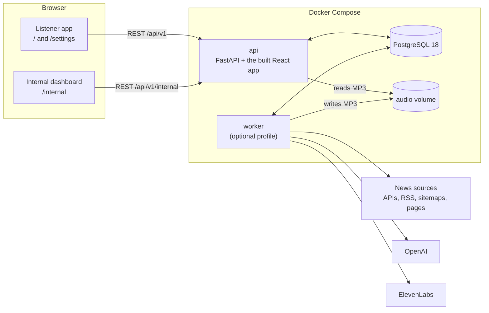

# Solution

A personal sports podcast generator. The listener sets their interests and how they want the show;
on their schedule, a worker gathers the news, writes a two-host conversation in which every fact
is checked against its source, voices it with ElevenLabs and masters it. An internal dashboard
shows whether listeners actually listen, and what each episode costs.

This document gives the overview, the architecture and the decisions that matter most. Each
decision has a full record, with the alternatives considered, the trade-offs and the evidence, in
[docs/decisions.md](docs/decisions.md) (D1 to D56). How to run it is in the [README](README.md).

## Contents

1. [The brief, and where each requirement is met](#1-the-brief-and-where-each-requirement-is-met)
2. [Scope](#2-scope)
3. [Architecture](#3-architecture)
4. [The life of an episode](#4-the-life-of-an-episode)
5. [Key decisions and trade-offs](#5-key-decisions-and-trade-offs)
6. [Keeping the facts honest](#6-keeping-the-facts-honest)
7. [Running unattended: the worker, the voice and spending](#7-running-unattended-the-worker-the-voice-and-spending)
8. [The internal dashboard and its simulated data](#8-the-internal-dashboard-and-its-simulated-data)
9. [The sample episode](#9-the-sample-episode)
10. [Costs](#10-costs)
11. [Testing](#11-testing)
12. [How I used AI tools](#12-how-i-used-ai-tools)
13. [Limitations](#13-limitations)
14. [Future improvements](#14-future-improvements)

---

## 1. The brief, and where each requirement is met

| Requirement | Where it is met |
| --- | --- |
| A UI where the user sets their interests and customises the podcast | `/settings`: catalogue sections with a weight each, the listener's own keyword topics, the show's name, length (3, 5 or 7 minutes), tone, the two hosts' names and personalities, and the schedule (days, time and time zone). `/` plays the episodes. ([D50](docs/decisions.md#d50--two-screens-and-a-minimal-custom-player), [D51](docs/decisions.md#d51--barça-football-and-basketball-are-two-sections-of-the-catalogue)) |
| On a given schedule, gather news on those topics and create an engaging audio | A worker queues each listener's episode on their schedule and runs a six-stage pipeline that ends in a mastered MP3 with chapters. ([D47](docs/decisions.md#d47--the-worker-one-polling-loop-a-short-claim-and-a-graceful-stop), [D48](docs/decisions.md#d48--when-episodes-are-made-and-how-much-they-may-spend), [D32](docs/decisions.md#d32--the-pipeline-runs-as-recorded-stages-behind-small-provider-interfaces)) |
| The backend pulls news from APIs or by scraping outlets' websites | Both: the official EuroLeague API and UEFA's data services, the Guardian's API (with an optional key), RSS feeds and sitemaps, and the data embedded in official pages (laliga.com, acb.com), all downloaded like a responsible crawler. ([D4](docs/decisions.md#d4--news-sources-behind-a-newsprovider-interface), [D30](docs/decisions.md#d30--sources-are-downloaded-like-a-responsible-crawler), [D31](docs/decisions.md#d31--official-data-is-read-from-the-data-inside-official-pages)) |
| An internal dashboard with usage metrics (mocked data allowed) | `/internal`: a Product tab (North Star and its inputs) and an Operations tab (cost, success, latency), with simulated listeners that can be switched off. ([D54](docs/decisions.md#d54--dashboard-metrics-are-computed-in-sql-from-one-definition-of-a-listen), [D55](docs/decisions.md#d55--simulated-data-lives-in-the-same-tables-marked-on-the-user), [D56](docs/decisions.md#d56--the-internal-dashboard-its-own-api-and-page-and-retries-for-real-runs-only)) |
| OpenAI and ElevenLabs keys provided | `gpt-6-sol` writes, `gpt-6-luna` selects and judges; ElevenLabs `eleven_v3` text-to-dialogue voices the two hosts. ([D5](docs/decisions.md#d5--one-openai-model-per-task), [D6](docs/decisions.md#d6--voice-elevenlabs-v3-text-to-dialogue)) |
| `solution.md` with an overview and the architectural decisions | This file, plus the 56 records in [docs/decisions.md](docs/decisions.md). |
| `sample.mp3` with the best episode generated with the product | [`sample.mp3`](sample.mp3): generated end to end by the pipeline, never edited by hand ([section 9](#9-the-sample-episode)). |

## 2. Scope

What I built, and what I left out on purpose:

- **One product with a generic pipeline, and a sports catalogue.** The pipeline has no
  club-specific logic: sections, weights, the running order and the show's format come from the
  listener's settings ([D38](docs/decisions.md#d38--the-shows-format-comes-from-the-listeners-interests)).
  The club only appears in the catalogue's sources and in examples inside the prompts. The
  catalogue covers FC Barcelona (football and basketball), LaLiga, the Champions League, the
  EuroLeague, the Liga ACB and the NBA, because those are the competitions where I found reliable
  official sources with player-level detail. Any other topic can be added as keywords.
- **Episodes are in English.** Some sources are in Spanish (the Liga ACB); the model writes
  English from them and the checks compare across languages.
- **It runs locally with Docker Compose,** with one demo listener and no login, and without keys
  until you want to generate. Deployment and authentication are the first future improvements
  ([section 14](#14-future-improvements)).

## 3. Architecture

- **Four Compose services:** `db` (PostgreSQL 18) and three built from one backend Dockerfile:
  `prestart`, a one-off job that applies the Alembic migrations and seeds the demo on a fresh
  database; `api` (FastAPI, which also serves the built React app, so there is one origin and no
  CORS); and `worker`, behind a Compose profile so that `docker compose up` never spends credits.
  The worker image adds ffmpeg; the API image does not need it
  ([D29](docs/decisions.md#d29--one-backend-dockerfile-with-a-cached-dependency-layer-and-two-targets),
  [D49](docs/decisions.md#d49--the-web-app-is-served-by-fastapi-from-the-same-image)).
- **PostgreSQL holds all the state except the audio files,** which live in a shared volume. The
  `episodes` table is the job queue; the pipeline's progress is recorded in `stage_runs`, every
  paid call in `provider_calls`, the stored sources in `articles`, and listening in
  `listen_events`
  ([D2](docs/decisions.md#d2--the-episodes-table-is-the-job-queue-drained-by-one-worker),
  [D25](docs/decisions.md#d25--the-data-model-grows-step-by-step-and-postgresql-enforces-it)).
- **The API never generates.** "Generate now" queues an episode and answers `202 Accepted`; the
  worker does the work. The API acts as the demo listener through a single `CurrentUser`
  dependency, so adding authentication changes one function
  ([D27](docs/decisions.md#d27--api-without-login-one-current-user-dependency-and-the-database-as-the-guard)).
- **Stack:** FastAPI, SQLAlchemy 2, Alembic, psycopg 3 and Pydantic 2 on Python 3.14; React 19,
  TypeScript, Vite, Tailwind, shadcn/ui, TanStack Query and Recharts. The provider SDKs are
  called directly, without an orchestration framework
  ([D1](docs/decisions.md#d1--stack-fastapi--postgresql--reacttypescript),
  [D3](docs/decisions.md#d3--a-staged-pipeline-with-checkpoints-using-the-provider-sdks-directly)).

## 4. The life of an episode

1. **Queued.** Either the worker's scheduler creates it (the listener's time, in their time zone,
   30 minutes early) or the listener presses "Generate now". A partial unique index allows one
   episode in flight per listener, so a double click queues one episode, not two.
2. **Claimed.** The worker takes the oldest queued episode with `SELECT … FOR UPDATE SKIP LOCKED`,
   checks the daily spending cap, and starts the pipeline, whose first commit marks it
   `in_progress` and releases the lock.
3. **Six stages,** each recorded in `stage_runs` with its paid calls. Each stage's output is saved
   when it finishes, so a retry resumes from the stage that failed without paying twice:

   | Stage | What it does | Who |
   | --- | --- | --- |
   | fetch | Downloads the latest items of every source into the shared store (the worker also ingests every three hours). | code |
   | select | Picks the candidate stories per section: what is new since the listener's last episode (scheduled or on demand), or a catch-up the first time. An editor then writes a plan (the lead story, its key facts, a short roundup), which code validates; code shares out the minutes by weight and picks each section's next game. | `gpt-6-luna`, `gpt-6-sol`, code |
   | write | Writes the two-host conversation from the plan. Every factual turn cites the ids of its sources. | `gpt-6-sol` |
   | check | Code checks and an LLM judge (section 6). Problems get one rewrite; a turn that still fails is repaired or removed. Only scripts that pass the checks reach the voice. | code, `gpt-6-luna` |
   | voice | Turns digits and names into speech ("three-one", "89 to 82"), then one ElevenLabs text-to-dialogue request per section (split between turns above 2,000 characters), cached by the hash of its text. Each chunk's duration and silence are checked. | ElevenLabs `eleven_v3` |
   | master | Joins the sections with ffmpeg, normalises to −16 LUFS, encodes a 128 kbps MP3 and records the chapter times. | ffmpeg |

4. **Ends** as `completed`, `failed` (with its reason, retryable) or `skipped` (nothing new to
   tell: no voice is paid and it is not a failure,
   [D19](docs/decisions.md#d19--an-episode-is-shorter-rather-than-padded)).
5. **Listened to.** The player sends listening events, which feed the dashboard (section 8).

## 5. Key decisions and trade-offs

The decisions I would defend first. Each links to its full record; sections 6 to 8 add only how
the less obvious ones work.

| Decision | Why | What I gave up |
| --- | --- | --- |
| **The `episodes` table is the queue, drained by one polling worker** ([D2](docs/decisions.md#d2--the-episodes-table-is-the-job-queue-drained-by-one-worker), [D47](docs/decisions.md#d47--the-worker-one-polling-loop-a-short-claim-and-a-graceful-stop)) | One job type, and the state already lives in PostgreSQL. `SKIP LOCKED` lets more workers be added without double work; no Redis or Celery to run and explain. A separate process, not a background task in the API, so a generation survives an API restart and the schedule needs no request. | Up to 10 s before a queued episode starts; no priorities. |
| **Six recorded stages with checkpoints** ([D3](docs/decisions.md#d3--a-staged-pipeline-with-checkpoints-using-the-provider-sdks-directly), [D32](docs/decisions.md#d32--the-pipeline-runs-as-recorded-stages-behind-small-provider-interfaces)) | Voice is the expensive part, so text is checked before it; a failure is visible in the database and a retry does not pay again. Small `Llm` and `Voice` interfaces let the tests run the whole pipeline for free. | More code than one prompt. |
| **Official data first, reference outlets for stories, never aggregators** ([D4](docs/decisions.md#d4--news-sources-behind-a-newsprovider-interface), [D31](docs/decisions.md#d31--official-data-is-read-from-the-data-inside-official-pages)) | A fact is only as reliable as its source, and the checks need the full text. Scores, standings and fixtures come from official data, rendered as plain-text sources with their own ids. | laliga.com and acb.com have no documented API: a redesign can break a provider (the ingest reports it at once). The NBA has no reachable official source. |
| **Sources are ingested every three hours into a store** ([D24](docs/decisions.md#d24--sources-are-ingested-on-a-schedule-and-stored)) | Official lists scroll: acb.com's round reports went from 9 to 6 visible in five hours. A catch-up episode must still reach them, and each source is downloaded once for all listeners. | Requests even when no episode is due; the store is kept for 30 days. |
| **A responsible crawler** ([D30](docs/decisions.md#d30--sources-are-downloaded-like-a-responsible-crawler)) | An honest User-Agent, `robots.txt` applied as RFC 9309 defines it (Protego; Python's own parser ignored wildcards and allowed disallowed URLs), a pause between requests to a site. | One small dependency; a site whose `robots.txt` errors is skipped for one ingest. |
| **Code does what code does reliably; the model does language** ([D19](docs/decisions.md#d19--an-episode-is-shorter-rather-than-padded), [D33](docs/decisions.md#d33--official-results-carry-the-players-and-code-computes-the-gaps), [D34](docs/decisions.md#d34--days-are-spoken-relative-to-the-episode-and-code-writes-the-labels), [D43](docs/decisions.md#d43--code-picks-each-sections-next-game-and-results-are-told-the-way-fans-tell-them)) | Models miscount characters, weekdays and totals. Code shares the minutes, labels each date as it should be said ("last Saturday"), writes goal totals and table gaps, and picks the listener's team's next game. The model never computes a number. | More code in selection. |
| **An editorial plan before writing** ([D37](docs/decisions.md#d37--an-editorial-plan-before-writing), [D39](docs/decisions.md#d39--the-writer-turns-the-plan-into-a-conversation-between-two-fans)) | Given a list of stories, the writer told every one like a news wire. A plan with one lead story per section, validated by code, turned it into a conversation. | One more paid call ($0.02 to $0.12 per episode). |
| **Shorter rather than padded** ([D19](docs/decisions.md#d19--an-episode-is-shorter-rather-than-padded), [D23](docs/decisions.md#d23--what-an-episode-covers-what-is-new-or-a-catch-up-the-first-time)) | Padding is where models invent. The length is a target: a section without fresh news is left out, whatever its weight, and with nothing new the episode is `skipped`. | Episode length varies; a quiet day can mean no episode. |
| **Check facts before paying for voice** ([D7](docs/decisions.md#d7--check-the-script-before-paying-for-voice), [D42](docs/decisions.md#d42--the-plan-keeps-the-sources-framing-and-a-rejected-turn-is-repaired-not-the-episode)) | The worst failure of a news podcast is a made-up fact. Section 6. | About $0.002 per episode for the judge, plus a rewrite when needed. |
| **ElevenLabs v3 text-to-dialogue, one request per section** ([D6](docs/decisions.md#d6--voice-elevenlabs-v3-text-to-dialogue), [D46](docs/decisions.md#d46--audio-elevenlabs-mp3-at-128-kbps-mastered-in-one-pass)) | Natural turn-taking between two voices in one request; one request per section gives the chapter times for free; a cache by text hash never pays twice. | v3 only (no cheaper models support dialogue); no fallback provider yet. |
| **The schedule in the listener's time zone, 30 minutes early, with no backlog** ([D48](docs/decisions.md#d48--when-episodes-are-made-and-how-much-they-may-spend)) | 07:00 in Madrid stays 07:00 across daylight saving; the episode is ready on time; a missed slot is caught up once (under 12 hours old), never as a burst of stale episodes. | A worker that was off for longer skips that day. |
| **A daily spending cap and a free default voice** ([D48](docs/decisions.md#d48--when-episodes-are-made-and-how-much-they-may-spend), [D11](docs/decisions.md#d11--cost-aware-development)) | The keys' balances cannot be read, and the worker runs unattended. Every paid call is recorded with its cost; the cap sums them over 24 hours. The whole flow can be tried without voice credits. | A capped episode ends `failed` (retryable), shown apart on the dashboard; a fresh install produces a tone until real voice is enabled. |
| **Runs with one command, without keys** ([D10](docs/decisions.md#d10--runs-locally-with-docker-compose-including-without-api-keys), [D26](docs/decisions.md#d26--migrations-with-alembic-applied-by-a-prestart-job), [D53](docs/decisions.md#d53--a-fresh-install-shows-the-sample-episode-without-keys)) | Reviewers only need Docker, and the API keys stay private. A `prestart` job migrates and seeds; the sample is seeded from the real episode, without the outlets' article text. | Migrations run on every `up`, right for a demo, not for production. |
| **Metrics in SQL from one definition of a listen** ([D8](docs/decisions.md#d8--internal-dashboard-product-and-operations), [D54](docs/decisions.md#d54--dashboard-metrics-are-computed-in-sql-from-one-definition-of-a-listen)) | Industry definitions (a stream is 60 s, Spotify; an engaged listen is 40 % of the episode, Apple), computed next to the data from one base query, so the numbers cannot contradict each other. | Long SQL strings, each covered by a test with known answers. |
| **Tests against a real PostgreSQL, with a sabotage for every check** ([D20](docs/decisions.md#d20--every-check-is-proven-by-a-sabotage-test-and-the-judge-is-measured), [D28](docs/decisions.md#d28--tests-run-against-a-real-postgresql)) | The model relies on `CHECK` constraints, partial indexes, `jsonb` and `SKIP LOCKED`. A check that has never failed proves nothing. | Tests need the development database running. |

## 6. Keeping the facts honest

The quality bar I set: no fact in an episode that its cited source does not support. It is
enforced in the `check` stage, before any voice is paid for
([D7](docs/decisions.md#d7--check-the-script-before-paying-for-voice)).

- **Code checks (deterministic, free).** Every number in a turn appears in a source that the turn
  cites; scores are compared as ordered pairs, so a reversed score fails; numbers are normalised
  by the source's language ("81,5" in Spanish is 81.5); a statistic written as words ("twenty
  points") is rejected, so the number check cannot be bypassed; every cited id exists; the text is
  clean for the voice (only allowed audio tags, no URLs, markdown or emojis); and the structure
  and length follow the plan. A style lint adds warnings ([D40](docs/decisions.md#d40--style-lint-length-control-and-a-record-of-every-episode)).
- **An LLM judge (`gpt-6-luna`)** reads every turn with the sources it cites: a turn without
  sources may only be an opinion or a transition; a factual turn must be supported, with the right
  team or player, the right day, the same scope for records ("the third-highest total in a league
  opener" is not "the third-highest ever") and no more certainty than the source ("reportedly"
  stays "reportedly").
- **One rewrite, then surgical repair.** Structural problems of the whole script get one rewrite and
  fail the episode if they remain. A turn that fails is rewritten on its own and judged again, then
  removed if it still fails; that fails the episode only if a section loses its lead story or is
  left empty ([D42](docs/decisions.md#d42--the-plan-keeps-the-sources-framing-and-a-rejected-turn-is-repaired-not-the-episode)).
- **Proven, not assumed.** Every check has a sabotage test that must be caught (an invented
  number, a reversed score, a number written as words, a rumour told as fact, a truncated audio
  chunk…). The judge was measured on 28 labelled claims about real sources, half of them
  Spanish, with the traps found in those sources, and it called all 28 correctly as pass or fail;
  on a real script it passed all 26 turns, which I had checked by hand against their sources
  ([D20](docs/decisions.md#d20--every-check-is-proven-by-a-sabotage-test-and-the-judge-is-measured)).
  Both samples are small, and the 28 claims were labelled by the AI assistant that built the
  checks, so they rule out gross errors rather than give an accuracy figure.

A real example of the system working: in one test run the editor's plan turned "Kevin Punter was
Barça's best player by valuation, with 19 points" into "Punter led Barça with 19 points". It read
well, even to a person; the judge rejected it, because the source never said he was the top
scorer. That led to the rule that the plan keeps the source's framing, and to repairing one turn
instead of failing a whole episode (D42).

## 7. Running unattended: the worker, the voice and spending

**The loop** (`app/worker.py`, every 10 seconds,
[D47](docs/decisions.md#d47--the-worker-one-polling-loop-a-short-claim-and-a-graceful-stop)):
recover episodes stuck `in_progress` for over 30 minutes (a killed worker) as `failed` and
retryable; queue the due slots; claim and run one queued episode (section 4); and every three hours
ingest the sources, after the episode, so a waiting listener comes first. A slot is never queued
twice: `INSERT … ON CONFLICT DO NOTHING` over `UNIQUE(user_id, scheduled_for)` and the
one-in-flight index is the guarantee
([D48](docs/decisions.md#d48--when-episodes-are-made-and-how-much-they-may-spend)).

**Stopping and failing safely.** Docker's SIGTERM sets a flag: the worker finishes the episode in
progress, starts nothing new and exits with code 0 (Compose waits up to 10 minutes). Without the
keys it needs, it exits and names them instead of restarting in a loop. Simulated listeners are
excluded from scheduling, claiming and the cap, each guard with its own test. In production the
worker would run on an always-on server; on a laptop that was off at 06:30, the catch-up rule
creates that morning's episode once, if it is less than 12 hours late.

**The voice.** `WORKER_VOICE=tone` (the default) makes ffmpeg generate a tone as long as the speech
would be, and the UI says so next to "Generate now". `WORKER_VOICE=elevenlabs` uses the real
voices, and then "Generate now" also requires `ELEVENLABS_API_KEY`: the API and the worker share
one rule for the required keys. The tone records no provider call, so `provider_calls` holds only
what a provider bills, and its model name is part of the voice cache key, so test audio is never
served as real audio ([D40](docs/decisions.md#d40--style-lint-length-control-and-a-record-of-every-episode)).
The two hosts are George, the presenter, and Sarah, the analyst: their names and personalities are
editable, and the voice ids are configuration, because ElevenLabs' default voices expire at the
end of 2026 ([D13](docs/decisions.md#d13--two-fixed-configurable-hosts)).

**Spending.** Costs come from OpenAI's `usage` and ElevenLabs' `character-cost` header
([D11](docs/decisions.md#d11--cost-aware-development)). The cap is `WORKER_DAILY_BUDGET_USD`
(default $1.00); the dashboard shows the same 24-hour figure the worker checks.

## 8. The internal dashboard and its simulated data

**Product tab.** The North Star is **engaged listens per week**: it measures value delivered, not
episodes generated, since an episode nobody hears only costs money. Its inputs: weekly engaged
listeners, the funnel (generated → played → stream of 60 s or more → engaged at 40 % or more), the
average share heard, activation (a new listener's first episode heard within 24 hours), the
drop-off curve, how many finish each section, weekly cohorts and on-time delivery of scheduled
episodes ([D8](docs/decisions.md#d8--internal-dashboard-product-and-operations),
[D54](docs/decisions.md#d54--dashboard-metrics-are-computed-in-sql-from-one-definition-of-a-listen)).

**Operations tab.** Outcomes (with spending-cap stops kept apart from failures), cost per
completed episode, runs, success rate, p50 and p95 duration and cost per stage, failures by stage,
the latest runs with a retry button for real ones, and the last 24 hours' spend against the cap.

**Definitions that keep the numbers honest.** The player sends `play` and one heartbeat for each
15-second slot of audio actually heard, and SQL counts distinct slots, so a replay cannot inflate
listening ([D52](docs/decisions.md#d52--listening-events-one-heartbeat-per-15-second-slot-actually-played)). The funnel ends 24 hours ago and
cohorts only count listeners who have lived the whole week, so recent episodes do not look unheard
just because they are new. The API returns counts, and the page divides.

**Simulated data** ([D55](docs/decisions.md#d55--simulated-data-lives-in-the-same-tables-marked-on-the-user)).
69 listeners over 8 weeks and about 1,200 episodes, generated deterministically in the same tables
as real data and marked on the user (`users.is_synthetic`). Costs and timings are calibrated on
this project's own runs; the listening patterns (early drop-off, sections skipped more than others,
listeners who fade) are invented, and the page says the data is simulated. A switch hides it; with
it off, the dashboard shows only real runs and real listening, through the same queries.

## 9. The sample episode

[`sample.mp3`](sample.mp3): "Barça & Beyond", 293.6 seconds, George and Sarah, −16.4 LUFS.

- **What it is.** The demo listener's first episode, a catch-up
  ([D23](docs/decisions.md#d23--what-an-episode-covers-what-is-new-or-a-catch-up-the-first-time)):
  Barça football, LaLiga, the Champions League, Barça basketball, the Liga ACB, the EuroLeague and
  the NBA, in that order, which comes from the listener's weights, grouped by sport.
- **How it was made** ([D45](docs/decisions.md#d45--the-sample-is-the-best-episode-the-product-generated-and-it-can-be-reproduced)).
  Text is cheap and voice is not, so I iterated on the text and voiced it once. Each weakness I
  found by reading a script became a general rule in the product, with a test, and the episode
  was generated again: never a script or audio edited by hand, never code for one episode. All
  versions ran as of the same moment, Monday 28 September 2026 at 23:32 in Madrid (`--as-of`,
  [D41](docs/decisions.md#d41--episodes-can-be-regenerated-as-of-a-past-moment)), so they compare
  the same news; that is why the episode says "It's Monday".
- **Chosen by reading.** Every fact of the finalists was checked against its sources, sentence by
  sentence. The chosen version won on the links between sections and the conversation, at the
  cost of a few striking statistics: at a fixed length, naturalness and data density compete.
- **Voice.** First a preview of the intro and the section with the hardest names, through the
  product's own voice functions; after listening, the full take reused it from the cache. The
  mastered file is byte-identical to what the pipeline wrote.
- **Cost of getting there.** Eleven text-only generations and one re-check, about $1.29 of
  OpenAI, including three failed runs that each led to a general fix, and 3,824 ElevenLabs
  characters (871 for the preview, 2,953 for the rest).
- **What I would still improve** (measured, not changed, since the sample was approved): the
  pauses between speakers inside a section last about one second, from ElevenLabs; shortening them
  in the master is free and would serve every episode
  ([D46](docs/decisions.md#d46--audio-elevenlabs-mp3-at-128-kbps-mastered-in-one-pass)).

A fresh install seeds this episode, with its chapters, transcript and sources, so reviewers can
play it in the app without keys. It is the only episode in the repository: later runs, including
the final real-voice test (section 11), stay in the development database.

## 10. Costs

**Per episode, measured.** The text of a 5-minute episode costs $0.06 to $0.24 of OpenAI: about
$0.06 when the plan and the script pass at once, more when the plan is asked again or the script
is rewritten. The real voice costs about $0.10 per 1,000 characters, and 5 minutes are about 3,700
to 3,900 characters (12.4 characters per second, measured in the spike), so about $0.38. A
5-minute episode with real voice therefore costs about $0.44 to $0.62, most of it voice. The final
real-voice run cost $0.41: $0.071 of OpenAI and 3,390 characters ($0.339).

**The whole project** (every paid call, from the first key test to the last end-to-end run):
about **$1.85 of OpenAI** and **7,948 ElevenLabs characters** (about $0.79 at $0.10 per 1,000).
Of those, $1.84 and 6,343 characters went through the pipeline and are recorded in
`provider_calls`, which is what the dashboard shows; the rest are the first key tests, the spike,
the judge's measurement and the sample's voice preview. That includes every sample iteration and
four end-to-end runs, one of them with real voice. Tests use fake providers, and every paid run in
development was estimated with a dry run first.

## 11. Testing

- **252 backend tests** (pytest) against a real PostgreSQL, with fake providers: no test makes a
  paid call. They cover the API, the constraints (each one is fed a bad value directly), the
  migrations (up, down and drift), every source parser, every pipeline stage end to end with real
  ffmpeg, the worker (two real connections claiming episodes concurrently), and each metric on
  hand-built data with known answers. Each check has its sabotage case (section 6).
- **Frontend:** type checking, ESLint, Prettier and the build; 8 Vitest tests for the listening
  counter, the one piece of client logic that feeds a metric.
- **End to end, with real providers:** in Docker, an episode generated by the worker and stopped
  mid-run to test the graceful stop; and from the browser, "Generate now" → worker → six stages →
  audio → a listen to 45 % → one engaged listen on the dashboard, for $0.15 of OpenAI and no voice
  credits. A later manual run from the web app ($0.11) found that the writer's prompt gave "It's
  Monday" as its example for the intro, and the model copied it on every other day. The judge kept
  it off the air, but it cost a rewrite and once the intro's opening turn; the example now takes the
  episode's weekday from code ([D39](docs/decisions.md#d39--the-writer-turns-the-plan-into-a-conversation-between-two-fans)).
- **Real voice, in Docker** (the last run before delivery): with `WORKER_VOICE=elevenlabs` in a
  local `.env`, "Generate now" in the web app → the worker in Docker → real OpenAI and six
  `eleven_v3` requests → the master in the container → played in the browser. 248 seconds, $0.071
  of OpenAI and 3,390 characters ($0.339), and the intro said the right weekday. It was the third
  episode that day, so it covered under three hours of news (section 13). Like every run, it stays
  in the development database; the sample is unchanged.
- **As a reviewer:** a fresh clone with no `.env` and an empty database, started with `docker
  compose up`: the sample plays, the dashboard is full, and generating answers `503` naming the
  missing key.

## 12. How I used AI tools

The brief encourages AI tools, and I used them intensively, mainly Claude Code, to research
sources and APIs, implement features, explore alternatives, review and debug code, write tests,
analyse results, and help draft documentation.

I directed the work and set the product and quality bar. For the important architectural and
product decisions, I discussed alternatives and trade-offs before choosing an approach; those
decisions are recorded in [docs/decisions.md](docs/decisions.md). I also explicitly approved paid
API calls, tested the application myself, listened to generated audio, reviewed the important
outputs and metrics, and asked for changes when a result did not meet the bar.

Most of the code was produced with AI assistance rather than typed manually by me. I do not treat
that as a substitute for understanding it: I take responsibility for the solution I am
submitting, including its decisions, trade-offs and known limitations.

I also used a small number of task-specific agent skills during development. They are listed in
the [AI tooling section of docs/decisions.md](docs/decisions.md#ai-tooling-agent-skills), together
with what they were used for.

## 13. Limitations

- **No authentication and a single demo listener.** The app is only published on `127.0.0.1`;
  `/internal` is as open as the rest of it.
- **Local only.** The worker must be running at the scheduled time (section 7).
- **The sources are a curated catalogue.** Two of them read the data embedded in official pages
  (laliga.com, acb.com), which can change without notice. The NBA has no reachable official
  source, so its section relies on ESPN and CBS Sports stories, without scores. Keyword topics only
  find what the catalogue and, with a key, the Guardian contain.
- **Source text goes into the prompts.** It is written by third parties and could carry
  instructions (prompt injection). The sources are a fixed catalogue, the rules and the sources go
  in separate parts of the request, the models have no tools and answer in a schema, and every
  fact is checked against its source; but there is no dedicated test
  ([D7](docs/decisions.md#d7--check-the-script-before-paying-for-voice)).
- **The judge is a model.** It can vary between runs (one test run flagged two sentences that it
  approved on the retry); the repair step and reading the scripts mitigate it. The checks reduce
  factual risk and enforce a few deterministic style rules; they guarantee neither factual
  correctness nor overall style.
- **Every episode moves the point from which news counts as new,** a manual one included. Several
  episodes in a day leave little that is new, and a section with nothing new is left out whatever
  its weight: the final test run, the third that day, covered 2 hours 44 minutes of news and had no
  Barça section ([D23](docs/decisions.md#d23--what-an-episode-covers-what-is-new-or-a-catch-up-the-first-time)).
- **The length is approximate.** It is budgeted in characters at the spike's 12.4 per second, and
  one rewrite aims for within 10% of that budget, but the voice's pace varies. The sample runs 4:54;
  the final test run, trimmed to 91% of its budget and spoken at 13.8 characters per second, ran
  4:08 for a 5-minute setting ([D19](docs/decisions.md#d19--an-episode-is-shorter-rather-than-padded)).
- **One worker, one episode at a time,** polling every 10 seconds. A worker killed hard blocks that
  listener for up to 30 minutes.
- **Simulated listening patterns are invented** (only costs and timings are measured), and the
  dashboard has fixed windows.
- **Voice:** about one second between speakers inside a section; no fallback voice provider.
- **Dependencies:** Python's direct dependencies are pinned exactly, but their transitive ones are
  not locked; the frontend is locked by `package-lock.json` (installed with `npm ci`).

## 14. Future improvements

In the order I would do them:

### To put it in front of real listeners

- Authentication, with a team role for `/internal`; deployment with the worker on an always-on
  server; migrations as an explicit deployment step; secrets in a secrets manager.
- Pause generation for listeners who stop listening: the funnel shows episodes that are paid for
  and never heard.
- Show the real ElevenLabs quota on the dashboard, if the key is given permission to read it;
  alerts for repeated failures or a spending cap close to being reached.

### Quality of the episodes

- Shorten the one-second pauses between speakers in the master (free, for every episode).
- Tell the listener when little is new: before "Generate now", and in the episode when a followed
  section has nothing new; or let an on-demand episode leave the scheduled one's starting point
  where it was.
- Budget the length with the speech rate each master measures, instead of the fixed 12.4
  characters per second.
- Judge twice and keep the majority, and grow the labelled set (or add a local hallucination model
  such as HHEM) to turn the judge's measurement into an accuracy figure.
- A prompt-injection test set, and an explicit rule that source text is data, never instructions.
- Guarantee in code that each section's freshest story reaches the plan; trim what the plan reads
  (13,000 to 17,500 tokens); count a season ("2013/14") as one number in the plan's rules.
- Word timestamps from the voice, to know exactly who speaks when; WER on the audio.
- A fallback voice provider (OpenAI TTS) for when ElevenLabs is down.

### Sources

- NBA scores from a permitted source; EuroLeague play-by-play for highlights; the Liga ACB table;
  the club's match reports from its news listing.

### Scale

- `LISTEN/NOTIFY` to wake the worker at once; more workers (the `SKIP LOCKED` claim is ready); a
  library such as Procrastinate if more job types appear.
- Metrics: an index by date on `listen_events`, daily rollups or materialised views, partitioning
  by month; keyset pagination for long lists.

### Engineering

- CI that runs the tests, regenerates the API types and fails if they differ; Playwright end-to-end
  tests and component tests in CI; a Python lock file for reproducible builds.
- Listening events sent in batches or with `sendBeacon`; host names stored in the script; a date
  range selector and CSV export on the dashboard.
- Keep "Generate now" disabled, with the episode's state, while one is queued or running; today a
  second press gets the database's `409`, shown as an error.
